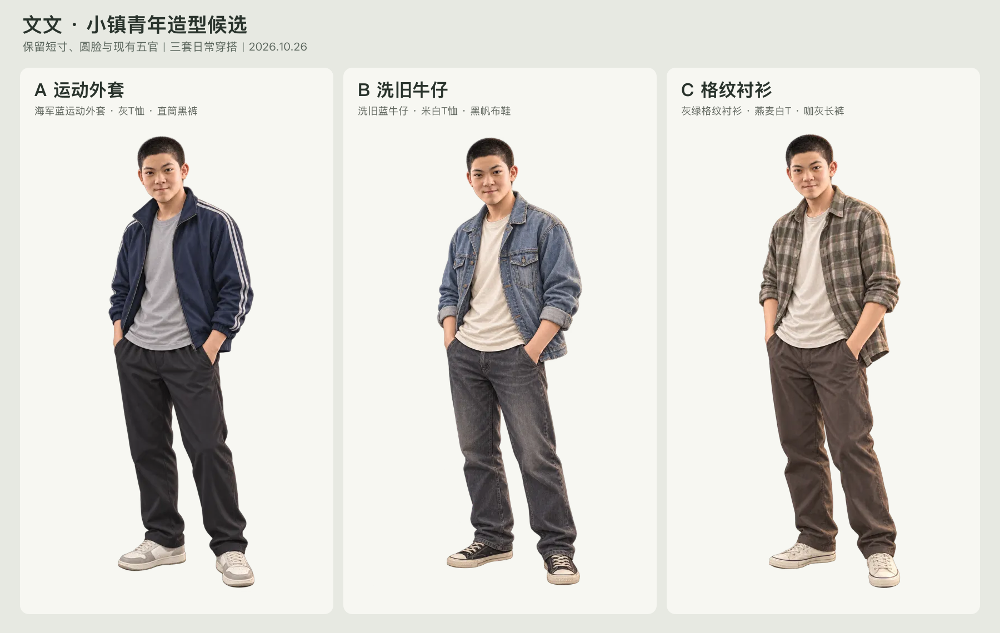

# 文文·小镇青年造型三方案

2026-10-26｜候选设计，待用户选择；使用内置 image_gen，每套独立生成。

**最新采用：** 用户已选用[黄发版](yellow-hair-v2/README.md)的 **B·洗旧牛仔**，现行整组资源见[生产交接](../wenwen-option-b-production-20261026/README.md)；下方黑发原方案保留供对照。

| 方案 | 设计与气质 | 独立立绘 |
| --- | --- | --- |
| A·运动外套（推荐） | 海军蓝运动外套、灰T恤、直筒黑裤与米白运动鞋；随和、有精力，适合日常主造型。 | [无损WebP](originals/a-sport.png) · [PNG原件](originals/a-sport.png) |
| B·洗旧牛仔 | 洗旧蓝牛仔夹克、米白T恤、炭灰牛仔裤与黑帆布鞋；松弛，带一点不服输的劲。 | [无损WebP](../../../archive/character-variants/wenwen-town-youth-options-20261026/b-denim.webp) · [PNG原件](originals/b-denim.png) |
| C·格纹衬衫 | 灰绿烟棕格纹衬衫、燕麦白T恤、咖灰长裤与米白帆布鞋；温和，生活感更强。 | [无损WebP](originals/c-plaid.png) · [PNG原件](originals/c-plaid.png) |

## 来源与验证

- 以[当前十章基础立绘](../../../archive/ten-chapter/characters/wenwen/char-wenwen-human-base.webp)为唯一身份参考，保留23岁、短寸、圆脸、既有五官和半写实画风，重新设计全身穿搭。三套均为同一角色的衣装候选。
- [完整提示词](prompts.json)与[生成路径、指纹及转换校验](generation-record.json)已保留；PNG原件原样复制。输出均为1024×1536透明立绘，WebP采用 `lossless: true, effort: 6`，未裁切、缩放或补底。
- 三张均通过真实WebP格式、解码、尺寸、逐像素alpha及所有可见RGB一致校验；编码器只改变部分全透明像素下不可见的RGB。原生alpha最大值254，转换未改写。对比图另行等比缩放排版。
- 目视检查完成：人物身份与衣装方向、全身构图、脸部、衣纹和鞋部无明显异常，浅底对比图无明显背景残留。三张深底检查见[明暗底校验图](../../../archive/character-variants/wenwen-town-youth-options-20261026/qa-light-dark.webp)。
- 未替换现有立绘、表情差分或运行引用；未修改剧情、构建、存档及部署。选定后再制作所需差分、游戏构图和接入；实际游戏加载尚未验证。
