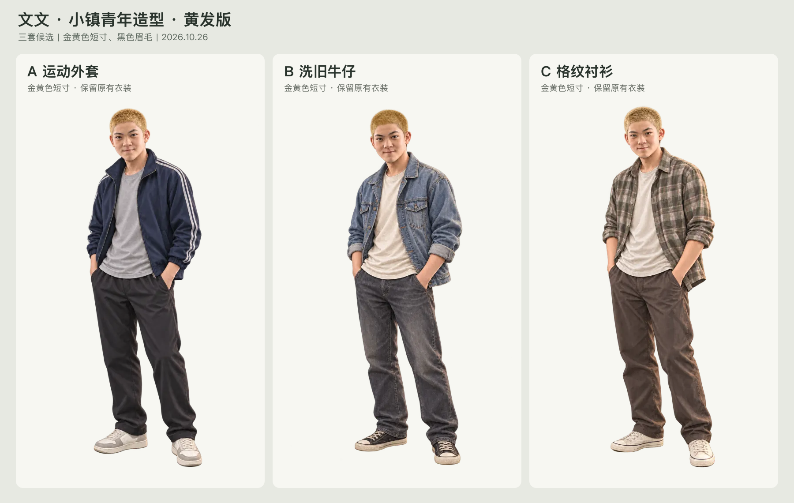

# 文文三套造型·黄发版

2026-10-26｜用户已确认采用 **B·洗旧牛仔黄发版**，现行整组资源见[生产交接](../../wenwen-option-b-production-20261026/README.md)。本页保留三套候选的生成与比较记录。

| 方案 | 无损WebP | 原始输出 |
| --- | --- | --- |
| A·运动外套 | [立绘](originals/a-sport.png) | [PNG](originals/a-sport.png) |
| B·洗旧牛仔 | [立绘](../../../../archive/character-variants/wenwen-town-youth-options-20261026/yellow-hair-v2/b-denim.webp) | [PNG](originals/b-denim.png) |
| C·格纹衬衫 | [立绘](originals/c-plaid.png) | [PNG](originals/c-plaid.png) |

- [完整提示词](prompts.json) · [来源、指纹与校验](generation-record.json) · [明暗底检查图](../../../../archive/character-variants/wenwen-town-youth-options-20261026/yellow-hair-v2/qa-light-dark.webp) · [原黑发方案](../README.md)。
- 三张均为1024×1536透明立绘。保留生成PNG原件，WebP使用 `lossless: true, effort: 6`；格式、解码、尺寸、alpha与可见RGB逐像素核对通过，仅完全透明像素下部分不可见RGB由编码器改写。转换未缩放或裁切。
- 已目视检查金黄色短发、脸部与衣装延续、全身构图及明暗底透明边缘，无明显异常。未替换游戏采用图、制作差分或执行游戏页面验收。
