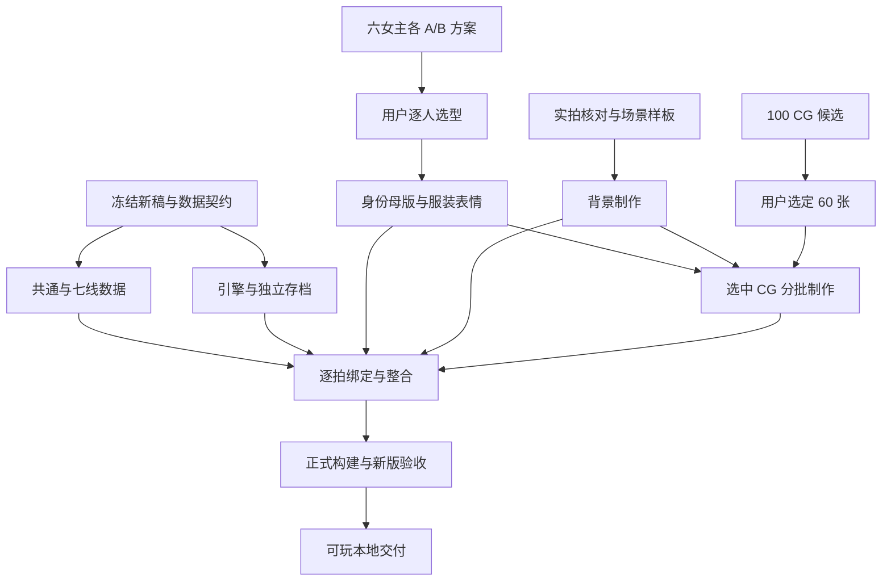

# 并行分工与可复制提示词

2026-10-27｜执行任务蓝图；本轮只完成计划。任务完成状态统一回写根目录 `TODO-v1.1.md`，由总协调负责，其他聊天提交交接后不抢写共享文档。

## 顺序与模型

本机当前可选模型中，建议 **GPT-6 Astra（`gpt-6-astra`）** 负责跨全文约束、视觉方向与交叉审查，**GPT-6.1 Sol（`gpt-6.1-sol`）** 负责数据转换、工具、绑定与代码。图像制作由图像生成／编辑工具执行，聊天模型负责提示词、参考选择和检查；不把语言模型名称当作图像工具的模型参数。

“极高／高／中／低”表示应提供的上下文范围，不是伪造的 token 上限：极高＝完整新稿与跨系统契约；高＝共通、所负责路线及相关契约；中＝已冻结的指定清单、母版与局部片段；低＝单项修复与明确验收证据。下表的模型与上下文为建议，运行时以本机可选项为准。

背景小样与角色选型可同时开展；图中的“背景制作→CG”只要求相应 CG 所用地点先定，不必等所有背景完成。数据与美术在同一资源 ID 契约下并行，未采用图不能进入正式包。

| 任务 | 建议模型／上下文 | 独占范围（拟定） | 前置与可并行关系 |
| --- | --- | --- | --- |
| V11-00 总协调／契约 | Astra／极高 | `任务拆分/v1.1/contract.*`、清单、根 TODO 与计划导航 | 先完成；接收各组交接、处理共享变更。 |
| V11-A 六女主方案 | Astra／高；图像工具制作 | 每人独立 `assets/sources/v1.1/characters/<人物>/design/` | 六人可并行；逐人交付 A/B，由用户选型。 |
| V11-B 人物差分 | Sol／高；图像工具制作 | 对应人物 `production/`、人物独立采用清单 | 该人选型后开始；可按人物拆窗口。文文／毛狼／师匠另组。 |
| V11-C 背景 | Astra／中；图像工具制作 | `assets/sources/v1.1/backgrounds/<分组>/` 与分组清单 | 实拍核对后开始；按毕节公共空间／室内／跨城拆组。 |
| V11-D 共通／后日谈 | Astra／极高，Sol实现 | `任务拆分/v1.1/common/`、`epilogue/`、对应来源映射 | 契约后，与路线和引擎并行；公共入口由该任务唯一维护。 |
| V11-R 七线转换 | Sol／高；复杂条件用 Astra复核 | `任务拆分/v1.1/routes/<route>.json` 及同路线交接 | 可七线并行；每个窗口只拥有一条线，不改共通。 |
| V11-E 引擎／播放器 | Sol／高 | `engine.js`、`game.js`、`player-runtime.js`、`save-compat.js`；需要时 `index.html`、`styles.css` | 契约后；只一个负责人改共享运行文件，美术问题用接口反馈。 |
| V11-G CG制作 | Astra／中；图像工具制作 | `assets/sources/v1.1/cg/<CG编号>/`、每图清单 | 选片＋涉及人物母版＋场景定型后；按已分配 ID 并行，不重复认领。 |
| V11-P 逐拍演出 | Sol／高；Astra审读 | `任务拆分/v1.1/presentation/<route>.json` | 节点契约冻结后可先写语义请求；最终绑定等真实节点和采用资源齐全。 |
| V11-I 构建与采用整合 | Sol／高 | 新版构建适配、`任务拆分/三章扩展/build-story.cjs`、最终 `assets/current/v1.1/`／manifest、生成产物 | 接收各组后串行；唯一写最终采用目录和根 `story.js`。 |
| V11-Q 独立验收 | Astra审读＋Sol检查／极高 | `qa/v1.1-<新批次>/` 与问题记录 | 可以提前写验证方案；正式测试等当前候选构建完成。发现代码问题交回 E／I 修复。 |

目录均为计划，不代表已创建或接口已支持。每个任务建立专属 `交接.md`，记录产物、实际验证、未完成项、依赖和已发现的跨组问题。总协调决定共享文件变更，防止各窗口互相覆盖。

## 推荐同时打开的聊天

首轮 4 个窗口最清楚：总协调／契约、六女主方案、场景制作准备、CG选片。角色任务量大时再按人拆分；每次只给新窗口该人物的完整依据。

第二轮可同时进行路线转换、播放器适配、人物差分、背景；CG 在相应参考齐全后加入。最后由整合负责人串行生成正式版本，再交独立 QA。不要让多个窗口同时修改根运行文件、最终采用清单或 TODO。

## 可直接复制的提示词

以下路径均相对 `/Users/yipin/Desktop/cjb-v1.1`。方括号内容在派发前替换为具体人物、路线或编号；没有替换不应执行批量生成。

### 任务 0：冻结契约

> 请在 `/Users/yipin/Desktop/cjb-v1.1` 执行 V11-00。先读 AGENTS.md、TODO-v1.1.md、项目文档/v1.1开发计划/README.md 和04-工程实施与验收.md，再完整读当前v1.1润色稿。建立新版来源指纹、稳定节点规则、69处选择／143选项、14主结局、条件后日谈、黄球球自主事件、服装表情接口和独立存档策略。检查旧构建器的17模块／13终结假设，提出最小适配。只写任务拆分/v1.1的契约与来源清单、自己的交接，并由总协调同步TODO；先交可审阅契约，不改正文或美术，不直接修改story.js。

### 任务 A：一位女主的两套方案

> 请负责 `[人物]` 的 v1.1 A／B形象设计。先读AGENTS、美术资源规范、01-人物美术与演出.md中该人物段、人物档案和该角色当前完整路线；实际查看当前采用图与对应参考。用户允许明显重设计脸部与服饰，优先新剧情。先核对方向，再用图像工具分别制作独立可查看的A与B两套，展示脸部近景、统一截幅日常造型、适用职业衣装示意及同尺度对照；黄球球保持半身，不自行补未确认下装。两套要有脸部、妆发、衣装剪裁的实质差别；明确保留原文外观特征，不擅改剧情。仅写assets/sources/v1.1/characters/[人物ID]/design/及本任务记录。保留工具原始输出与参考；运行衍生优先WebP。交付两个选项、差别、推荐理由和待用户选型项，不扩生成全表情或CG、不写最终采用图，不只完成一个选项就报完成。

### 任务 B：选定人物的表情与衣装

> 请根据用户已选的 `[人物／方案／母版版本]`，执行该人物生产。先核对冻结的母版、当前路线、衣装表和实际镜头组合，列出本批使用组合再制作。只写assets/sources/v1.1/characters/[人物ID]/production/及人物清单。每个衣装先验同脸、同身形、坐标和透明边缘，再扩所需表情／动作，不做无用途全排列。交付源图、无损透明WebP、明暗底合成对照、ID、参考和参数、适用节点请求、实际检查与未完成项。不能用笑脸覆盖明确拒绝，也不能跨服装或形态回退；不改剧情、共享运行文件、最终采用目录与TODO。

### 任务 C：背景制作

> 请负责03-场景与实拍参考.md中的 `[背景ID列表]`。逐张查看对应实拍和当前可复用背景，核对原文场景、时间、天气、空间用途与道具。先交一张与选定人物风格一致的小样，再制作已确认本批；没有实拍的地点必须明确是设计方案，不声称真实地标还原。仅写assets/sources/v1.1/backgrounds/[本组]/及清单，不修改参考原件、历史图或最终采用目录。区分独立地点与时段版本，背景不画死剧情人物，保留生成原件，WebP编码与对照检查按规范执行。交付来源、尺寸、场景适用范围与待验项，不改剧情。

### 任务 D/R：共通或单路线数据

> 请负责 `[common+epilogue 或一个 route ID]` 的 v1.1游戏数据转换。先读冻结契约、当前共通篇和所负责全文、选择设计与04-工程实施与验收.md，检查实际文件，不从旧方案覆盖重写。只写契约指定的本模块JSON、来源映射与本任务交接。逐段保留叙述、对白、分支、AB/BA/BB前因和唯一结局；不新增隐藏分数，不改正文。每个节点映射原文，导入／导出和资源请求闭合；对同一选择序列比较文稿与模块实际读到的文本。共通／后日谈由专属负责人维护，单路线不得改共享入口或其他路线。只交隔离数据，不改生成story.js或播放器。

### 任务 E：播放器和存档

> 请执行V11-E，独占修改engine.js、game.js、player-runtime.js、save-compat.js，必要的index.html／styles.css变更也由你统一负责。根据已冻结v1.1契约做最小适配，保留现有公开接口和事务性选择验证，支持新版内容声明、自动事件、服装表情解析、CG显示／解锁／回顾及独立存档。旧存储原字节保留，不自动迁移旧剧情进度；测试使用新端口与独立浏览器上下文。先在隔离样例验证机制，再与正式源整合测试；区分两者证据。不得改路线正文、采用图片或直接手改story.js。交付实际验证、边界和待正式数据复验项。

### 任务 G：已选 CG 的分批制作

> 请只制作用户已选且分配给你的 `[CG编号列表]`，读取02-CG候选100张.json、最终选片JSON、对应原文和冻结人物／衣装／场景参考。先提交每图分镜与触发条件核对，再用图像工具制作；人物面貌、手部、道具、场景和事件发生顺序必须符合原文。只写assets/sources/v1.1/cg/[具体编号]/及记录，每个编号独占，不改最终清单或游戏。原始输出保留，运行优先WebP；每图提供构图、字幕安全区、引用参考、参数、剧情条件及实际检查。返工、裁切与表情修改不另占CG编号；不画不存在的婚礼、送站等情节，不把E1亲密动作绑定E2。

### 任务 P/I：演出绑定与最终整合

> 请按 `[演出单线／最终整合]` 分配执行。以真实v1.1节点和已采用资源为唯一输入；逐拍核对在场、服装、形态、表情、头像、背景、CG进入退出和分支条件。电话消息中的人不放入现场；第一人称不强制显示文文；所有回退显式登记，不跨形态或衣装。演出任务只写自己路线presentation文件，不改正文状态；最终整合任务统一迁入assets/current/v1.1并更新新版manifest、来源指纹、构建适配和生成输出。只有整合负责人运行根正式构建。交付资源闭合检查、真实构建结果与待浏览器验证项，不把旧报告视为新版通过。

### 任务 Q：独立验收与交付

> 请在新的qa/v1.1-[任务日期批次]/执行V11-Q。先记录当前正文、代码、资源指纹，确认候选构建为v1.1。按04-工程实施与验收.md验证来源文本、7线28关键组合、14结局、普通选项、黄球球相识／形态、PI-E1排除及PI-E2／FR-E2后日谈、独立存档、60张CG的条件显示与回顾。浏览器实际检查五种尺寸并截图；Chrome模拟、Safari、实体设备分别记录，未执行标待验。只写本批QA与问题交接，代码和美术问题交回所属负责人。通过后检查可玩交付包，不配置或推送未指定的发布目标；报告实际执行内容、未完成项和依赖。

[总计划](README.md) · [工程验收](04-工程实施与验收.md)
