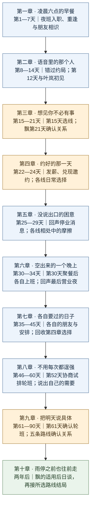
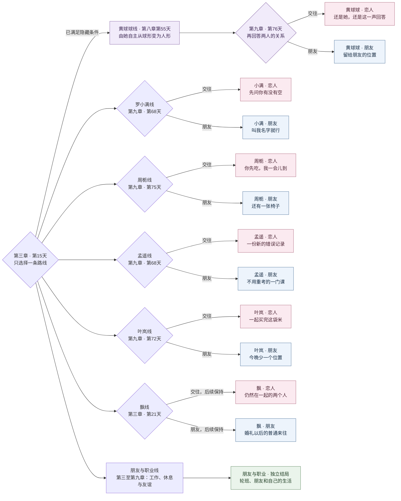
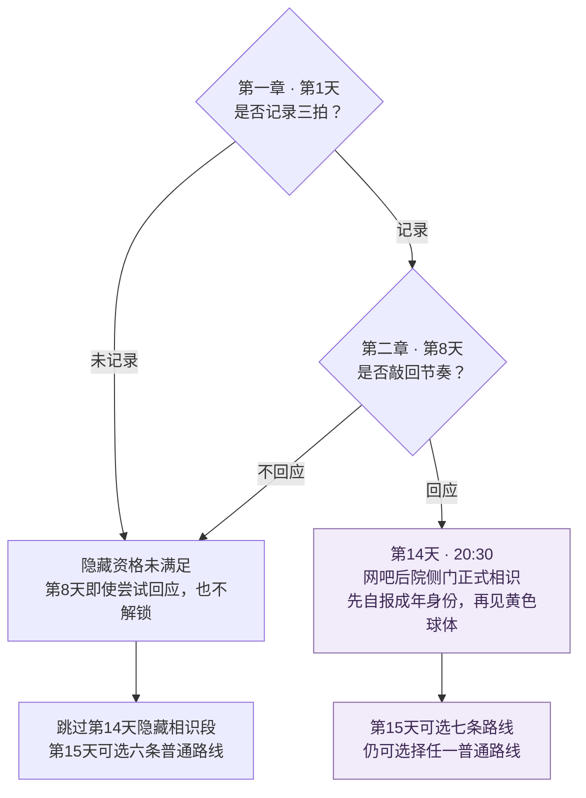
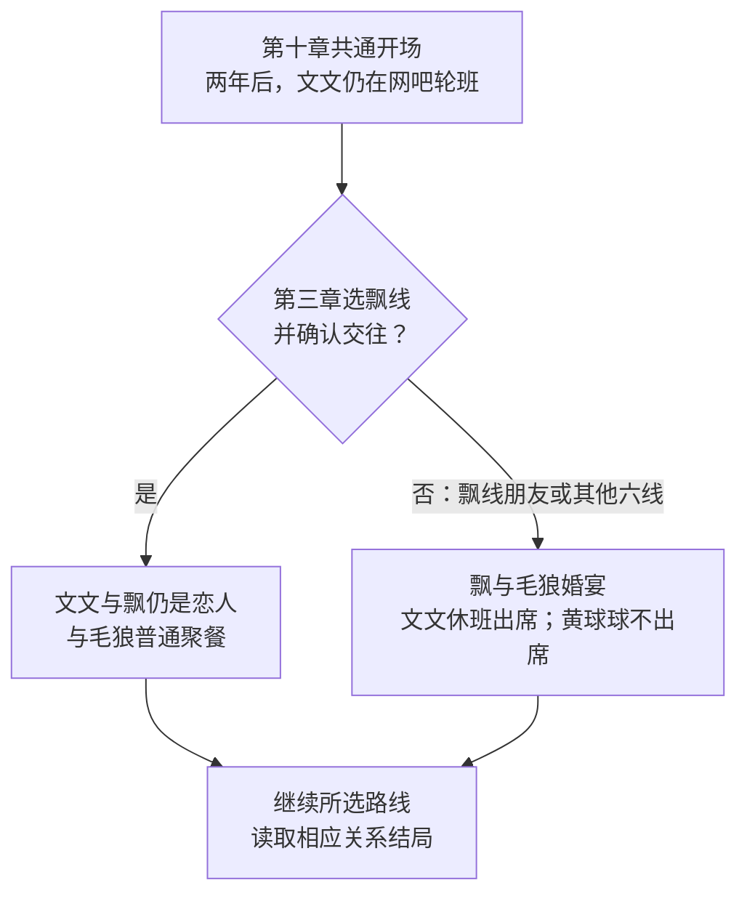

# 十章故事流程图

更新：2026-10-22｜依据网吧夜班版[全十章审阅稿](../故事/全十章审阅稿/README.md)

第一、二章共通，第三章选一条路线，之后每章先读共通段，再读同一路线，直到两年后。七条路线互斥，不会在一次阅读中依次经历所有人的私人故事。以下是待用户修改的故事流程，新版尚未接入游戏。

[十章主线](#十章主线) · [七条路线与13种结局](#七条路线与13种结局) · [黄球球进入条件](#黄球球进入条件) · [选择与回收](#选择与回收) · [第十章后日谈分流](#第十章后日谈分流)

## 十章主线

第30天傍晚聚餐后，周栀回回声上最后一班，文文22:00—06:00照常值班；第31天凌晨回声结束营业。第六章孟遥、叶岚段落补叙同一顿饭后的相处，不是再吃一次。第52天仅试排，第61天才确认轮班；两年后文文仍在网吧工作。

## 七条路线与13种结局

下图定位选线、关系回答与终点，中间各章仍须顺序阅读。飘在第三章确认关系并贯穿第四至第九章；其余五位女主在第九章确认，朋友与职业线独立收束。第十章先经过[后日谈分流](#第十章后日谈分流)，再读图中的对应结局。

合计为 **6位女主 × 2种关系结局＋朋友与职业线1种＝13种**。第十章的两段飘关系后日谈是条件共通段，不额外计为第14、15种结局。选择朋友不会在后文自动变成恋人；飘线也不会在第九章重新选择。

## 黄球球进入条件

解锁只增加黄球球这个选项，不自动选线。选她后，第七章第42天铺垫另一种样子，第八章第55天17:00由她自主从球形变为[用户照片参考的人形](../人物/黄球球.md#已确认外形与资源)。第九章才选择交往或朋友，两种结局都保留人形；变身不取决于恋爱选择。她仍不通过手机联系、不向普通路线人物显露，第十章也不出席飘与毛狼的婚宴。详见[隐藏线节点表](黄球球隐藏线.md#新版审阅稿路线)。

## 选择与回收

前三章的前情选择不提前锁定关系；正式选线发生在第三章第15天。隐藏条件单列于上图。

| 前情选择 | 后文回收 |
| --- | --- |
| 第4天见孟遥：承认紧张／先问空档 | 第三章孟遥线，对应重逢时的回应。 |
| 第10天错过约局：发语音说明／发文字并重约时间 | 第五章共通段，在新的约局中说清值班与可参加时段。 |
| 第12天见叶岚：聊共同游戏／先问想吃什么 | 第三章叶岚线，回想第一次线下相处。 |

第四章每条路线各有一组日常选择，第七章只读实际选择对应的回收；A、B都不直接决定恋爱结果。

| 路线 | 第四章选择A | 第四章选择B | 第七章回收 |
| --- | --- | --- | --- |
| 罗小满 | 投篮机，输的人买水 | 旧书摊，给对方挑怪书 | 第39天：第三局投篮／第二只纸鹤。 |
| 周栀 | 沿河走，轮流放歌 | 去影院，各自表达喜好 | 第43天：换她分享歌／换她挑电影。 |
| 孟遥 | 旧书摊，各挑一本书 | 街机厅，试气垫球 | 第43天：交换书与纸条／记起比分，再试双人划船。 |
| 叶岚 | 河边放风筝 | 旧货市场找小东西 | 第43天：再放风筝／再逛旧货市场。 |
| 飘 | 折一只纸船 | 猜店名的来历 | 第39天：纸船的回忆／店名的后续。 |
| 朋友与职业 | 和毛狼看小演出 | 沿街散步 | 第40天：自己再看演出／自己再逛那条街。 |
| 黄球球 | 文文画自画像，由她点评 | 轮流接讲鸭子买伞的故事 | 第40天：重看自画像／允许鸭子的故事暂不继续。 |

具体选项与回收正文见[第四章](../故事/全十章审阅稿/第四章-约好的那一天.md)和[第七章](../故事/全十章审阅稿/第七章-各自要过的日子.md)。读同章另一项时，应把它视为另一条可能经历。

## 第十章后日谈分流

这是各路线到第十章后共同使用的阅读顺序，不能用婚宴替代文文自己的结局。

后日谈和各路线结局都发生在两年后的生活中，不要求同一天。婚宴只确认飘与毛狼的关系，不影响文文在所选路线里已经作出的交往／朋友选择。

[十章正文目录](../故事/全十章审阅稿/README.md) · [分支索引](README.md) · [选择与解锁规则](选择与解锁规则.md)
